# VERA Module RBL-XE

<div align="center">

[](https://www.gnu.org/licenses/gpl-3.0)
[](https://www.kicad.org/)
[](#)
[](https://atari.com)
[](https://www.espressif.com/)

*🌐 English | [🌐 Italiano](#vera-module-rbl-xe-italiano)*

</div>

> [!WARNING]
> **v1.0 — PRE-PRODUCTION.**
> The PCB is routed and passes KiCad's DRC; the first boards are being made and are **not tested
> yet**. Firmware (ESP32, FPGA) and documentation have only been checked in simulation or on
> paper and may contain errors.

<div align="center">

**Commander X16 graphics and sound for the Atari XL/XE, through the PBI and cartridge slots.**

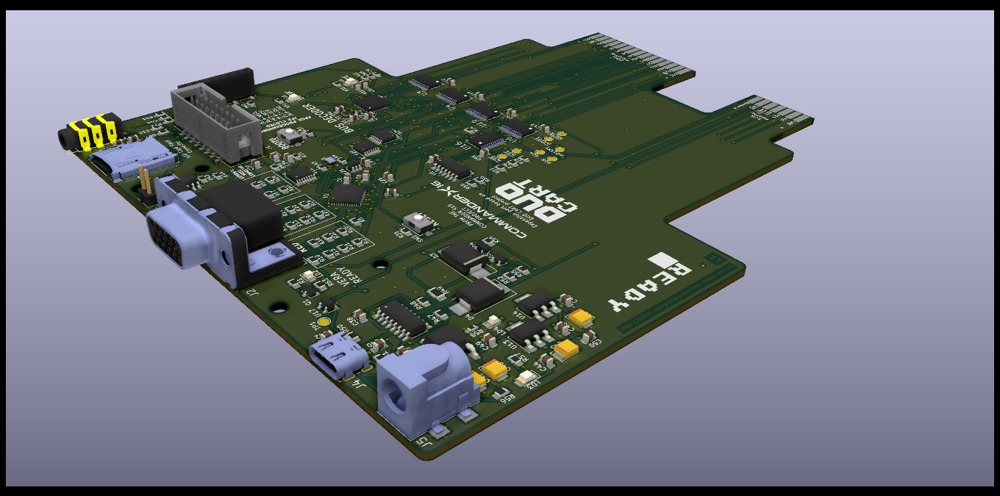

</div>

## 🎮 What it can look like

What a game can look like on the VERA (320×240, 256 colours). These are **illustrative mock-ups
of two original demo games, not captures from the board**; `tools/make_demo_shots.py` draws them.

<div align="center">
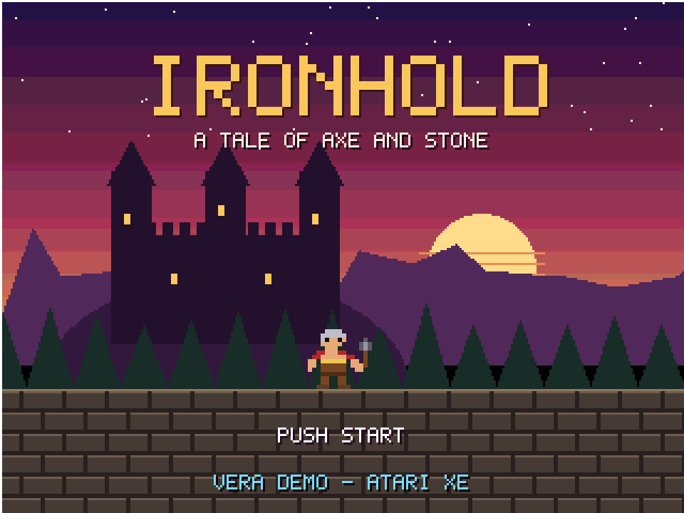
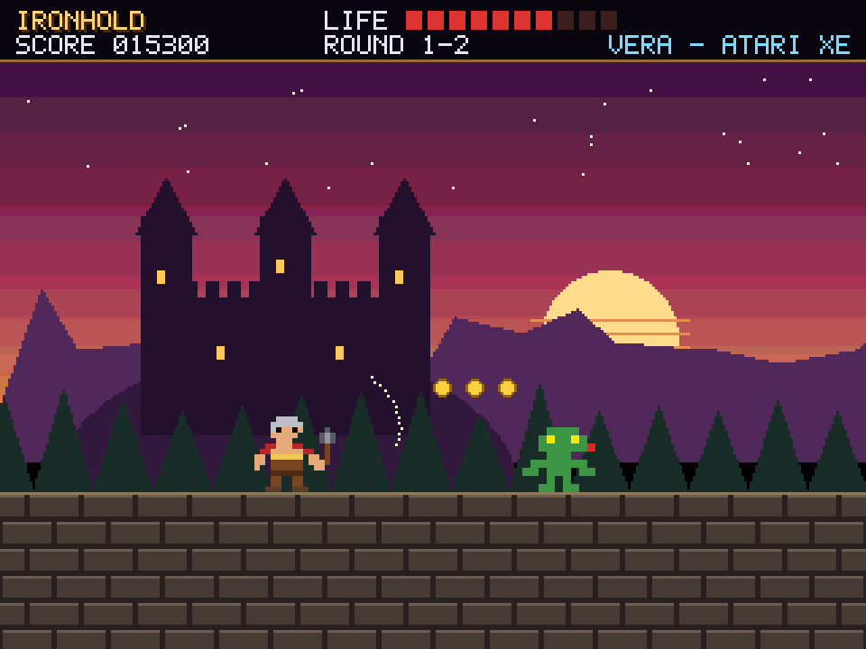
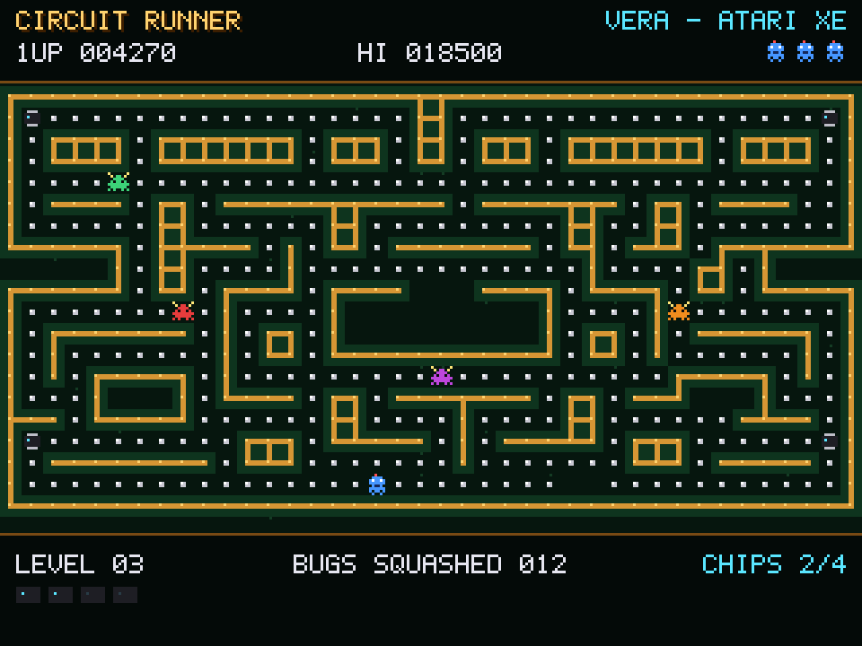

*IRONHOLD (side-scrolling action) and CIRCUIT RUNNER (maze chase)*
</div>

## 📦 v1.0 — pre-production

- **USB:** CH340C USB-serial (internal clock, no crystal) on USB-C, with ESP32 auto-reset.
- **U11 WM8524** (C146242) is short at JLCPCB: it is in `jlcpcb-global-sourcing.txt`; choose
  **Global Sourcing** for that row when ordering.
- The BOM XML comes straight from the KiCad 5 schematic (`utilities/kicadcli`), which stops on
  parts without annotation; `./output_job.sh 1.0` makes the JLCPCB files.

---

<div style="background: #ffffff; border-radius: 16px; padding: 24px; margin: 24px 0; box-shadow: 0 4px 12px rgba(0,0,0,0.1); border: 1px solid #e0e0e0;">

## 📋 Table of Contents

- [🔍 Overview](#-overview)
- [✨ Features](#-features)
- [⚙️ Technical Specifications](#️-technical-specifications)
- [🔧 Hardware Components](#-hardware-components)
- [🖼️ Board Preview](#️-board-preview)
- [📐 PCB Layers](#-pcb-layers)
- [🔌 Connectors & Interfaces](#-connectors--interfaces)
- [⚡ Power Requirements](#-power-requirements)
- [🔨 Assembly Instructions](#-assembly-instructions)
- [📦 Bill of Materials](#-bill-of-materials)
- [💻 Programming & Configuration](#-programming--configuration)
- [📁 Project Structure](#-project-structure)
- [🤝 Contributing](#-contributing)
- [📄 License](#-license)

</div>

---

<div style="background: #ffffff; border-radius: 16px; padding: 24px; margin: 24px 0; box-shadow: 0 4px 12px rgba(0,0,0,0.1); border: 1px solid #e0e0e0;">

## 🔍 Overview

The **VERA Module RBL-XE** is a sophisticated FPGA-based audio and video 
expansion card designed specifically for **ATARI XE** computers. 
This module brings modern graphics and audio capabilities to classic ATARI systems 
through the **PBI (Parallel Bus Interface)** protocol connectors.

### What is VERA?

**VERA** (Video Enhanced Retro Adapter) is originally designed for the 
Commander X16 computer but has been adapted for ATARI systems. It provides:

- **Advanced Graphics**: Multiple video layers, sprites, and high-resolution modes
- **Enhanced Audio**: Multi-channel digital audio with PCM and PSG capabilities  
- **Modern Connectivity**: VGA output, SD card storage, and USB programming
- **Retro Compatibility**: Integration with ATARI software with simple drivers

</div>

---

<div style="background: #ffffff; border-radius: 16px; padding: 24px; margin: 24px 0; box-shadow: 0 4px 12px rgba(0,0,0,0.1); border: 1px solid #e0e0e0;">

## ✨ Features

### 🎨 Graphics Capabilities

#### Video Output
- **VGA Output**: 640x480 @ 60Hz with analog RGB signals
- **Multiple Layers**: Background, foreground, and sprite layers
- **Color Depth**: 256 colors from a palette of 4096
- **Sprites**: Hardware-accelerated sprite engine
- **Scrolling**: Smooth horizontal and vertical scrolling

#### Audio Features
- **Digital Audio**: High-quality PCM audio output
- **Multi-channel**: Stereo audio
- **Audio Codec**: WM8524 for professional audio quality
- **3.5mm Jack**: Standard audio output connector

### 🔗 System Integration

#### ATARI Compatibility
- **PBI Interface**: Direct connection to ATARI XE systems
- **Memory Mapping**: $D1XX-$DFXX address space
- **Bus Decoder**: Full software address decoding in ESP32 — A0–A15 sampled every PHI2 cycle, no external hardware decoder required
- **Power Management**: Efficient 5V to 3.3V/1.2V conversion

#### Storage & Programming
- **SD Card Slot**: Micro SD for data storage and ROM loading
- **SPI Flash**: 16Mbit W25Q16 for FPGA configuration
- **USB Programming**: CH340C USB-to-serial on USB-C, with ESP32 auto-reset
- **SPI**: Direct FPGA programming interface

</div>

---

<div style="background: #ffffff; border-radius: 16px; padding: 24px; margin: 24px 0; box-shadow: 0 4px 12px rgba(0,0,0,0.1); border: 1px solid #e0e0e0;">

## ⚙️ Technical Specifications

### Core Specifications

| Component | Specification |
|-----------|---------------|
| **FPGA** | Lattice ICE40UP5K-SG48ITR |
| **Microcontroller** | ESP32-S3FN8 |
| **Flash Memory** | W25Q16JVSNIQ (16Mbit) |
| **Audio Codec** | WM8524CGEDT |
| **USB Interface** | CH340C (internal clock, no crystal) |
| **Power Regulators** | AMS1117-3.3V, AMS1117-1.2V, L7805 |
| **Crystal (VERA board)** | 25 MHz ECS-2033-250-BN (ICE40UP5K reference clock) |
| **Crystal (ESP32-S3)** | 40 MHz external — required; XTAL\_P (QFN56 pin 54) / XTAL\_N (pin 53) |
| **PCB Layers** | 4-layer (Signal/Power/GND/Signal) |
| **Board Size** | TBD mm x TBD mm |

### Electrical Characteristics

| Parameter | Min | Typ | Max | Unit |
|-----------|-----|-----|-----|------|
| **Supply Voltage** | 4.5 | 5.0 | 5.5 | V |
| **Current Consumption** | - | 800 | 1200 | mA |
| **Operating Temperature** | -10 | 25 | 70 | °C |
| **VGA Output Impedance** | - | 75 | - | Ω |
| **Audio Output Level** | - | 2.0 | - | Vrms |

</div>

---

<div style="background: #ffffff; border-radius: 16px; padding: 24px; margin: 24px 0; box-shadow: 0 4px 12px rgba(0,0,0,0.1); border: 1px solid #e0e0e0;">

## 🔧 Hardware Components

### Main Processing Units

#### FPGA - ICE40UP5K
- **Logic Elements**: 5,280 LUTs
- **Memory**: 120 Kbit BRAM, 1 Mbit SPRAM
- **I/O Pins**: 39 user I/O
- **Package**: QFN-48 (7x7mm)
- **Programming**: SPI configuration

#### ESP32-S3FN8
- **CPU**: Dual-core Xtensa LX7 @ 240 MHz
- **Memory**: 8 MB in-package Quad SPI flash, 512 KB SRAM
- **Connectivity**: Wi-Fi 802.11 b/g/n, Bluetooth 5 LE
- **GPIO**: 45 total (38 usable), all bidirectional
- **Package**: QFN-56 (7×7 mm)
- **Crystal**: requires an external **40 MHz crystal** on dedicated analog pins XTAL\_P (QFN56 pin 54) and XTAL\_N (pin 53) — mandatory for PLL startup; see PIN-MAPPING.md § 5
- **Role**: Full software 6502-bus controller — reads A0–A15, PHI2, R/W every cycle and drives EXTSEL\_N, DEV\_SEL\_N, MPD in real time; handles PBI ($D1xx) and CCTL ($D5xx) in a single unified firmware
- **Timing**: hot loop on Core 0 at max FreeRTOS priority (Core 1 only prints the log on Serial), table-driven page decode; control signals asserted via **Dedicated GPIO** Xtensa TIE instructions (`ee.get_gpio_in` / `ee.wr_mask_gpio_out`, 1 CPU cycle) within the 279 ns PHI2-high window of the 1.79 MHz 6502 clock

### Interface Components

#### Audio System
- **Codec**: WM8524CGEDT (24-bit, 192kHz)
- **Interface**: From FPGA digital audio bus
- **Output**: 3.5mm stereo jack
- **SNR**: >100dB

#### Video System
- **Output**: 15-pin VGA connector
- **Resolution**: 640x480 @ 60Hz
- **Colors**: 8-bit RGB (256 colors)
- **Sync**: Separate H/V sync signals

</div>

---

<div style="background: #ffffff; border-radius: 16px; padding: 24px; margin: 24px 0; box-shadow: 0 4px 12px rgba(0,0,0,0.1); border: 1px solid #e0e0e0;">

## 🖼️ Board Preview

### 3D Renderings

#### Top View
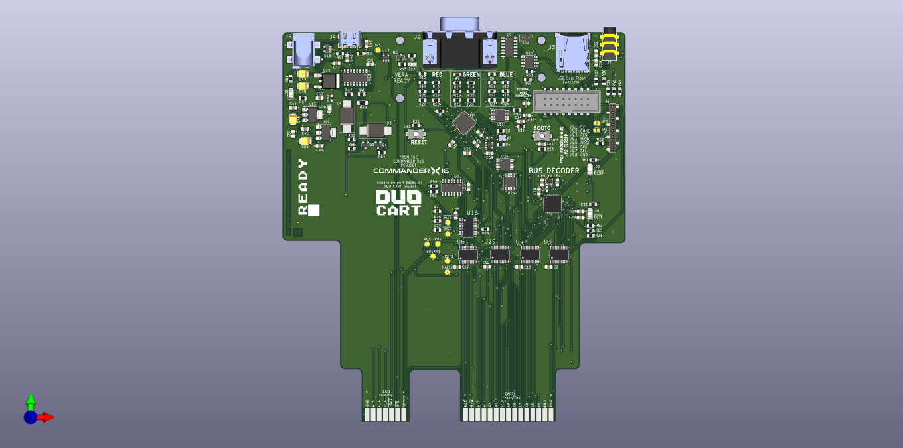
*Top side showing main components and connectors*

#### Bottom View  
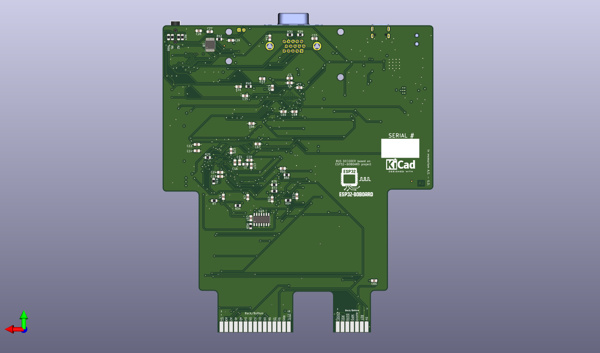
*Bottom side with additional components*

#### Cartridge Adapter
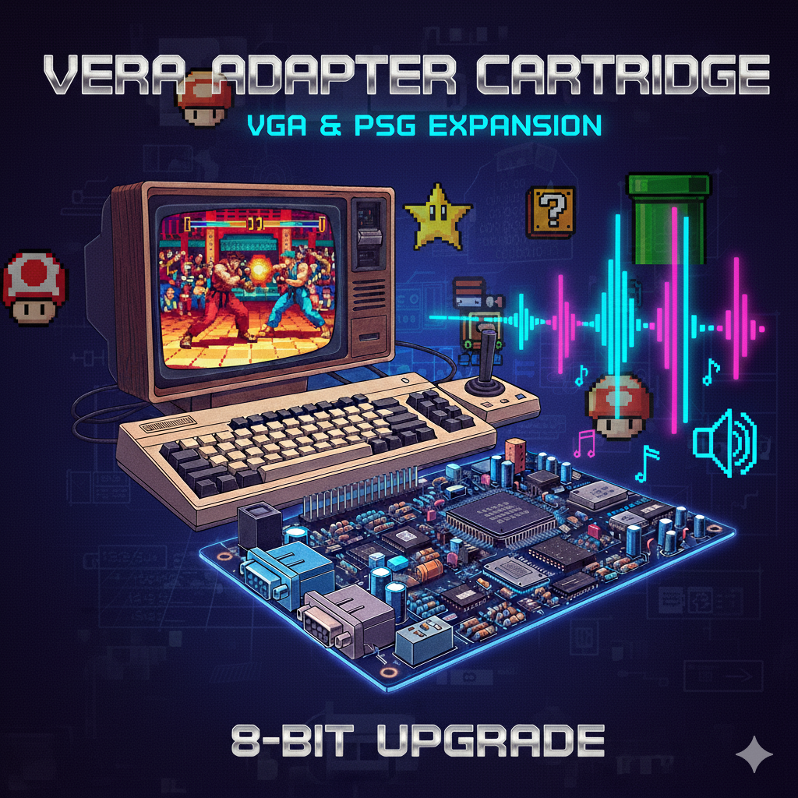
*Optional cartridge interface adapter*

### Board Dimensions

- **Length**: TBD mm
- **Width**: TBD mm  
- **Thickness**: 1.6mm (4-layer PCB)
- **Mounting**: Compatible with ATARI XE CART + ECI slots
- **Connectors**: Flat for space efficiency. It needs a custom 3D printed case

</div>

---

<div style="background: #ffffff; border-radius: 16px; padding: 24px; margin: 24px 0; box-shadow: 0 4px 12px rgba(0,0,0,0.1); border: 1px solid #e0e0e0;">

## 📐 PCB Layers

### Layer Stack-up

#### Layer 1 - Top Copper (F.Cu)
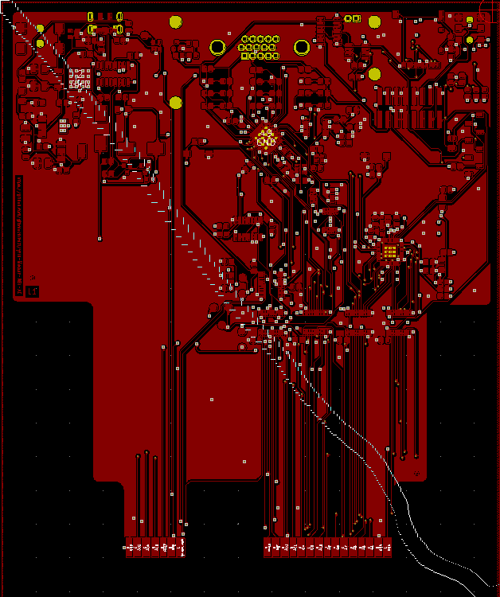
*Component placement and signal routing*

#### Layer 2 - Power Plane (POWER)
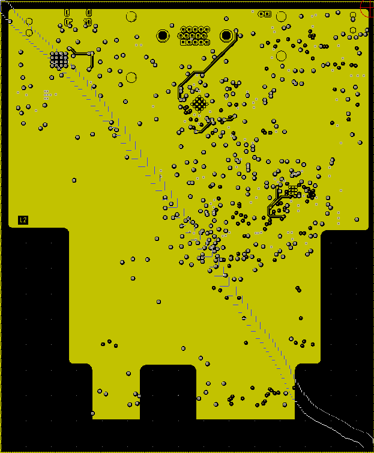
*5V, 3.3V, and 1.2V power distribution*

#### Layer 3 - Ground Plane (GND)
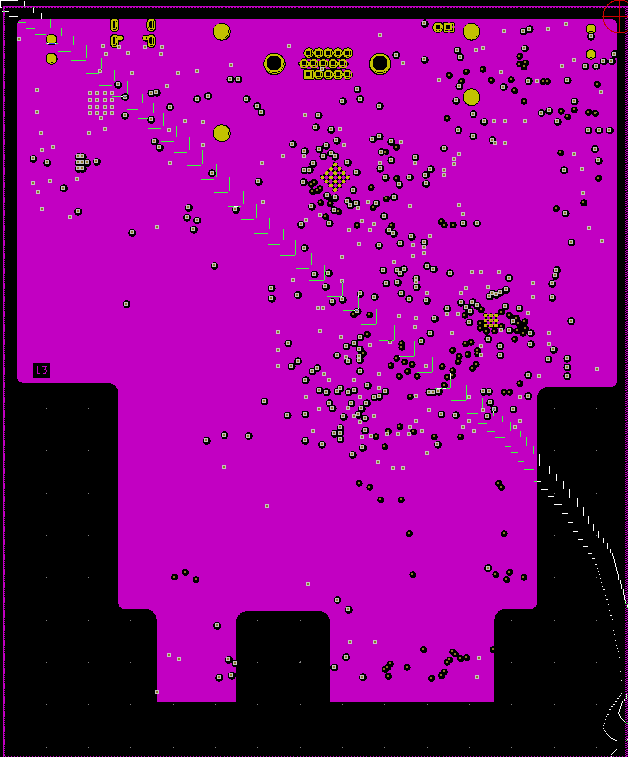
*Solid ground plane for signal integrity*

#### Layer 4 - Bottom Copper (B.Cu)
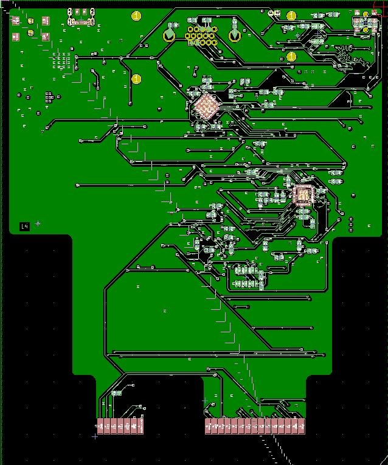
*Additional signal routing and components*

</div>

---

<div style="background: #ffffff; border-radius: 16px; padding: 24px; margin: 24px 0; box-shadow: 0 4px 12px rgba(0,0,0,0.1); border: 1px solid #e0e0e0;">

## 🔌 Connectors & Interfaces

### External Connections

#### ATARI XE Interface
- **Cartridge Connector**: Classic Cartridge Edge Connector 30 pin 
- **ECI Slot**: Enhanced Cartridge Interface 14 pin 
- **Address Range**: $D1XX-$DFXX
- **Signals**: Data bus, address bus, control signals

#### Video Output (J2)
| Pin | Signal | Description |
|-----|--------|-------------|
| 1-3 | RGB | Red, Green, Blue analog signals |
| 13-14 | H/V Sync | Horizontal/Vertical sync |
| 6-10 | GND | Ground connections |
| 11-12 | Audio L/R | Stereo audio output |

#### Storage Interfaces
- **SD Card Slot (J3)**: Micro SD card interface
- **SPI Flash**: On-board 16Mbit storage
- **USB Port (J4)**: Programming and data transfer

> ⚠ **Program the board only when it is unplugged from the Atari.** The board 5 V rail is tied to the
> Atari +5 V (cartridge pin 13, ECI pin 7) without a diode: with the USB cable (J4) or the DC jack (J5)
> connected while the board is in the Atari, the board would power a switched-off Atari or run in
> parallel with its supply. The same applies to the serial monitor: inside the Atari use a USB adapter
> without VBUS. See `VERA-ATARI-HW-REQUIREMENTS.md` §2.11.

### Programming Interfaces

#### ICEPROG Connector (J6)
| Pin | Signal | Function |
|-----|--------|----------|
| 1 | 5V | Power supply |
| 2 | FPGA_CDONE/PULL-UP | FPGA Programmed |
| 3 | FPGA_RESET | FPGA Reset |
| 4 | MISO | SPI data in |
| 5 | MOSI | SPI data out |
| 6 | SCK | SPI clock |
| 7 | SS | SPI select |
| 8 | GND | Ground |

#### Reset & Control
- **Reset Button (SW1)**: ESP32 system reset
- **DIP Switch (SW2)**: Configuration options
- **Status LEDs**: Power, programming, activity indicators

</div>

---

<div style="background: #ffffff; border-radius: 16px; padding: 24px; margin: 24px 0; box-shadow: 0 4px 12px rgba(0,0,0,0.1); border: 1px solid #e0e0e0;">

## ⚡ Power Requirements

### Power Distribution

#### Power Rails
| Rail | Voltage | Current | Components |
|------|---------|---------|------------|
| **5V** | 5.0V ± 5% | 200mA | Input from ATARI, USB |
| **3.3V** | 3.3V ± 3% | 400mA | ESP32, logic, interfaces |
| **1.2V** | 1.2V ± 3% | 300mA | FPGA core voltage |

#### Power Sources
1. **ATARI PBI**: Primary 5V supply from computer
2. **USB**: Alternative 5V for programming/testing
3. **External**: Optional external 5V supply (J5)

#### Power Protection
- **Schottky Diodes**: Reverse polarity protection
- **Ferrite Beads**: EMI filtering
- **Decoupling**: Extensive capacitor network
- **Current Limiting**: Overcurrent protection

</div>

---

<div style="background: #ffffff; border-radius: 16px; padding: 24px; margin: 24px 0; box-shadow: 0 4px 12px rgba(0,0,0,0.1); border: 1px solid #e0e0e0;">

## 🔨 Assembly Instructions

### Component Assembly

#### Assembly Order
1. **SMD Components**: Start with smallest components (0603, 0805)
2. **ICs**: Place all integrated circuits
3. **Connectors**: Install all external connectors
4. **Through-hole**: Add any remaining THT components
5. **Testing**: Verify power rails before first power-on

#### Special Considerations
- **FPGA**: Use proper ESD precautions
- **BGA Components**: Requires professional assembly
- **Thermal Management**: Ensure adequate cooling
- **Impedance Control**: Maintain 50Ω for high-speed signals

### Testing & Validation

#### Power-On Tests
1. **Visual Inspection**: Check for shorts, proper orientation
2. **Power Rails**: Verify all voltages within tolerance
3. **Clock Signals**: Confirm oscillator operation
4. **Communication**: Test SPI, I2C, UART interfaces

#### Functional Tests
1. **FPGA Programming**: Load test bitstream
2. **Video Output**: Verify VGA signal generation
3. **Audio Output**: Test audio codec functionality
4. **ATARI Interface**: Confirm PBI communication protocol

</div>

---

<div style="background: #ffffff; border-radius: 16px; padding: 24px; margin: 24px 0; box-shadow: 0 4px 12px rgba(0,0,0,0.1); border: 1px solid #e0e0e0;">

## 📦 Bill of Materials

### Component Categories

#### Major Components
- **1x** ICE40UP5K-SG48ITR FPGA
- **1x** ESP32-S3FN8 Microcontroller  
- **1x** W25Q16JVSNIQ SPI Flash
- **1x** WM8524CGEDT Audio Codec
- **1x** CH340C USB Interface

#### Passive Components
- **23x** 1µF Capacitors (1206)
- **20x** 100nF Capacitors (1206)
- **6x** 10µF Capacitors (1206)
- **Various** Resistors (0805/1206)
- **1x** 25 MHz Crystal Oscillator (VERA board — ICE40UP5K reference clock)
- **1x** 40 MHz Crystal + 2×10 pF load capacitors (ESP32-S3 — mandatory)

#### Connectors
- **1x** 15-pin VGA Connector
- **1x** Micro SD Card Slot
- **1x** USB Type-C Connector
- **1x** 3.5mm Audio Jack
- **1x** 8-pin Programming Header

### Cost Analysis

| Category | Estimated Cost | Percentage |
|----------|----------------|------------|
| **FPGA** | $15-20 | 35% |
| **ESP32** | $8-12 | 20% |
| **Connectors** | $5-8 | 15% |
| **Passives** | $3-5 | 10% |
| **PCB** | $8-12 | 20% |
| **Total** | **$39-57** | **100%** |

*Costs are estimates for small quantity production*

</div>

---

<div style="background: #ffffff; border-radius: 16px; padding: 24px; margin: 24px 0; box-shadow: 0 4px 12px rgba(0,0,0,0.1); border: 1px solid #e0e0e0;">

## 💻 Programming & Configuration

### FPGA Programming

#### Programming Methods
1. **iceprog** with an FTDI FT232H / FT2232H adapter on J6 (steps below)
2. **openFPGALoader**, same wiring

#### Programming Steps (iceprog, through J6)

<div align="center">
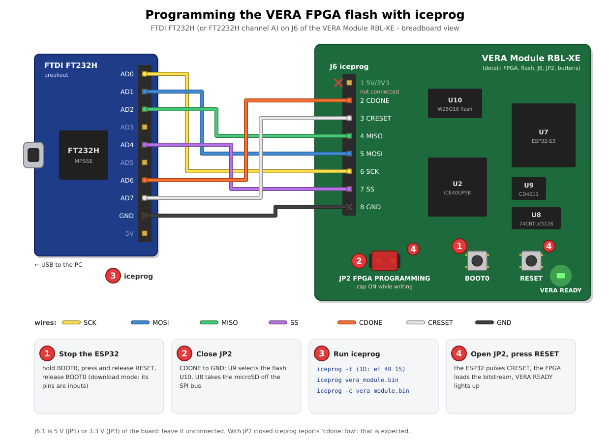
</div>

The VERA bitstream lives in the SPI flash U10 (W25Q16); the FPGA loads it at power-up.
`iceprog` writes it through **J6** with an FTDI FT232H or FT2232H adapter (MPSSE):

| J6 pin | Signal | FT232H / FT2232H (channel A) |
|---|---|---|
| 1 | 5 V (JP1) or 3.3 V (JP3), solder jumper | not needed: leave it unconnected |
| 2 | CDONE | ADBUS6 |
| 3 | CRESET | ADBUS7 |
| 4 | MISO (flash DO) | ADBUS2 |
| 5 | MOSI (flash DI) | ADBUS1 |
| 6 | SCK | ADBUS0 |
| 7 | SS (flash /CS) | ADBUS4 |
| 8 | GND | GND |

1. Power the board (in the computer) and **stop the ESP32**: hold BOOT0 (SW3), press and release
   RESET (SW1), release BOOT0. In download mode its pins are inputs; running, the firmware drives
   CRESET (GPIO 38) high against iceprog.
2. **Close JP2** ("FPGA PROGRAMMING"): CDONE goes to GND, so U9 selects the flash and U8 takes
   the microSD off the SPI bus.
3. Write and verify the flash:
   ```bash
   sudo apt install fpga-icestorm      # iceprog
   iceprog -t                          # reads the flash ID (W25Q16: ef 40 15)
   iceprog vera_module.bin             # erase, write, verify (the bitstream is not provided)
   iceprog -c vera_module.bin          # verify only
   ```
   With JP2 closed iceprog reports `cdone: low`: that is expected.
4. **Open JP2** and press RESET (SW1): the ESP32 firmware pulses CRESET, the FPGA loads the new
   bitstream and CDONE goes high (the "VERA READY" LED lights up).

#### Development Tools
- **IceStorm**: Open-source FPGA toolchain
- **Yosys**: Verilog synthesis
- **NextPNR**: Place and route
- **KiCad**: PCB design and layout

### ESP32 Configuration

#### ESP32 Firmware
The ESP32-S3FN8 (Core 0 hot loop, Core 1 serial log) handles:
- **Startup sync**: CRESET asserted LOW immediately in `setup()` (before `Serial.begin`), released, then CDONE polled until the ICE40UP5K bitstream is loaded (< 100 ms typical, 5 s timeout) before the bus loop starts. The Atari cannot be held in reset: the 130XE drives RST (ECI pin 2) straight from its NE555 output, so the board only reads it (GPIO 48 via U6). If the board is not ready when the OS scans the PBI devices at power-on, press RESET
- **Bus Decoding**: Full software decode of A0–A15 sampled on every PHI2 rising edge — no page ambiguity
- **Dedicated GPIO**: Control signals (EXTSEL\_N, DEV\_SEL\_N, MPD) asserted in a single Xtensa TIE instruction (`ee.wr_mask_gpio_out`, 1 CPU cycle) within the 279 ns PHI2-high window
- **Data Bus Drive** *(PBI mode only)*: D0–D7 driven via `GPIO.out` for ROM ($D800–$DFFF) and RAM ($D600–$D7FF) reads; FPGA drives the bus in CCTL mode
- **Debugging**: UART0 on GPIO43 (TX) / GPIO44 (RX), 115200 baud

The operating mode is selected at compile time via `VERA_BOARD_IS_PBI` in `main.cpp`:

| `VERA_BOARD_IS_PBI` | Mode | Active ranges | Selection latch |
|---------------------|------|---------------|-----------------|
| `1` (default) | PBI | $D100–$D1FF, $D600–$D7FF, $D800–$DFFF | write `0x80` to $D1FF |
| `0`           | CCTL | $D500–$D5FF                           | write `0x80` to $D5FF |

The **RAMbo 256 KB** emulator is always present: no GPIO, jumper or build option turns it on
or off. PORTB (`$D301`) bit 4 = 0 opens the 256 KB bank-switched window at $4000–$7FFF; with
bit 4 = 1 the Atari internal RAM responds as usual. GPIO 3 is not used by the firmware (it only
has the `R71` strapping pull-up).

Works in both PBI and CCTL mode. The hot loop snoops both **PBCTL** (`$D303`) and
**PORTB** (`$D301`): writes to `$D301` update the bank-selection register **only when**
PBCTL bit 2 = 1 (output register selected). When bit 2 = 0, `$D301` addresses the PIA
6520 DDR and the write is ignored for bank-switching purposes. `PORTB` initialises to
`0xFF` (RAME = 1, RAMbo inactive); `PBCTL` to `0x00` (bit 2 = 0, DDR exposed).

**Passive snooping vs. active driving — no conflict with the physical 6520.** The real
6520 PIA chip remains fully active on the Atari motherboard and responds to `$D301`/`$D303`
normally. The ESP32 does **not** replace the 6520 — it only snoops those bus cycles
(observes without driving). It only actively drives the data bus and asserts EXTSEL\_N
for the `$4000–$7FFF` window, where the 6520 is not mapped. PBCTL tracking is necessary
precisely because the snooping is passive: from the bus, a DDR write and an Output Register
write to `$D301` are **indistinguishable** — PBCTL state is the only way to tell them apart.

#### Programming ESP32
The firmware is built with **PlatformIO** (install via `pip install platformio`):
```bash
# Build firmware (edit VERA_BOARD_IS_PBI in main.cpp before building)
pio run -e esp32s3fn8

# Flash firmware — through the USB-C port (on-board CH340C on UART0, GPIO 43/44)
pio run -e esp32s3fn8 --target upload
```

> **Note**: USB CDC is disabled because GPIO 19 (USB D−) and GPIO 20 (USB D+) are reused
> as address lines A7 and A8. The on-board CH340C (USB-C) is wired to UART0 (GPIO 43/44)
> and resets the ESP32 into the bootloader through DTR/RTS: no external adapter is needed.

</div>

---

<div style="background: #ffffff; border-radius: 16px; padding: 24px; margin: 24px 0; box-shadow: 0 4px 12px rgba(0,0,0,0.1); border: 1px solid #e0e0e0;">

## 📁 Project Structure

The design workflow, from the schematic to the JLCPCB order (stock check, library update, ERC, netlist, PCB and net classes, DRC, `output_job.sh`, files to send), is described in [WORKFLOW.md](WORKFLOW.md) (in Italian, also as [PDF](WORKFLOW.pdf)).

### Repository Organization

```
Vera-Module-RBL-XE/
├── 📄 README.md                    # This documentation
├── 📄 WORKFLOW.md                  # Design workflow, schematic to JLCPCB order
├── 📄 PIN-MAPPING.md               # ESP32-S3 / level-shifter pin mapping
├── 📄 VERA-ATARI-HW-REQUIREMENTS.md # Hardware requirements & bring-up plan (from driver/emulator work)
├── 📄 LICENSE                      # GPL v3 license
├── ⚙️ VERA-MODULE-RBL.pro         # KiCad project file
├── 📄 VERA-MODULE-RBL.sch         # Main schematic
├── 🔧 VERA-MODULE-RBL.kicad_pcb   # PCB layout
├── 📄 VERA-MODULE-RBL.csv         # Bill of materials
├── 🐍 jlcpcb-check-bom.py        # BOM processing script
├── 📁 images/                      # Board images and renders
│   ├── 🖼️ VERA-MODULE-RBL-TOP.png
│   ├── 🖼️ VERA-MODULE-RBL-BOTTOM.png
│   ├── 🖼️ F.Cu-L1.png            # PCB layer images
│   ├── 🖼️ POWER-L2.png
│   ├── 🖼️ GND-L3.png
│   └── 🖼️ B.Cu-L4.png
├── 📁 production/                  # Manufacturing files
│   ├── 📄 *.gbl, *.gtl            # Gerber files
│   ├── 📄 *.drl                   # Drill files
│   └── 📄 *.gbrjob                # Job files
├── 📁 ibom/                       # Interactive BOM
│   └── 🌐 ibom.html
└── 📁 schematics/                 # Individual schematics
    ├── 📄 vera-fpga.sch           # FPGA module
    ├── 📄 busdecoder.sch          # Bus decoder
    ├── 📄 cartridgeInterface.sch   # Cartridge interface
    ├── 📄 vera-fpga-flash.sch     # Flash memory
    └── 📄 powersupply.sch         # Power management
```

### Hardware notes (read before bring-up)

- [`VERA-ATARI-HW-REQUIREMENTS.md`](VERA-ATARI-HW-REQUIREMENTS.md) — what the VERA FPGA
  requires from the bus, open points on this board (U19 output enable, WR hold time,
  push-pull IRQ), the gating logic for the data-bus transceiver output enable,
  reset/configuration sequence and the bring-up test plan.

### Design Files

#### KiCad Files
- **Schematic**: Multi-sheet hierarchical design
- **PCB Layout**: 4-layer board with controlled impedance
- **3D Models**: Custom component models
- **Footprints**: Custom connector footprints

#### Manufacturing Files
- **Gerber Files**: Industry-standard PCB fabrication
- **Drill Files**: NC drill and via specifications  
- **Pick & Place**: SMT assembly coordinates
- **BOM**: Component specifications with LCSC part numbers

</div>

---

<div style="background: #ffffff; border-radius: 16px; padding: 24px; margin: 24px 0; box-shadow: 0 4px 12px rgba(0,0,0,0.1); border: 1px solid #e0e0e0;">

## 🤝 Contributing

### Development Guidelines

#### Contributing Process
1. **Fork** the repository
2. **Create** a feature branch
3. **Make** your changes
4. **Test** thoroughly
5. **Submit** a pull request

#### Contribution Areas
- **Hardware Design**: PCB layout improvements
- **Firmware**: ESP32 and FPGA code
- **Documentation**: User guides and tutorials
- **Testing**: Validation and verification
- **Software**: Host applications and tools

#### Design Goals
- **Compatibility**: Maintain ATARI XE compatibility
- **Performance**: Optimize for speed and efficiency
- **Reliability**: Ensure robust operation
- **Manufacturability**: Design for production
- **Cost**: Balance features with affordability

</div>

---

<div style="background: #ffffff; border-radius: 16px; padding: 24px; margin: 24px 0; box-shadow: 0 4px 12px rgba(0,0,0,0.1); border: 1px solid #e0e0e0;">

## 📄 License

This project is licensed under the **GNU General Public License v3.0**.

### License Details

#### Permissions
- ✅ Commercial use
- ✅ Modification
- ✅ Distribution
- ✅ Patent use
- ✅ Private use

#### Limitations
- ❌ Liability
- ❌ Warranty

#### Conditions
- 📄 License and copyright notice
- 📄 State changes
- 📄 Disclose source
- 📄 Same license

For the complete license text, see the [LICENSE](LICENSE) file.

</div>

---

<div style="background: linear-gradient(135deg, #1976d2, #42a5f5); color: white; border-radius: 16px; padding: 32px; margin: 32px 0; box-shadow: 0 8px 24px rgba(25,118,210,0.3); text-align: center;">

## 💙 Support the Project

If you find this project useful, please consider:

🌟 **Starring** the repository  
🐛 **Reporting** issues  
🔧 **Contributing** improvements  
📢 **Sharing** with the community  

---

**Made with ❤️ by RetroBit Lab**

*Bringing modern capabilities to classic computers*

</div>

---

# VERA Module RBL-XE (Italiano)

<div align="center">

*[🌐 English](#vera-module-rbl-xe) | 🌐 Italiano*

</div>

> [!WARNING]
> **v1.0 — PRE-PRODUZIONE.**
> Il PCB è sbrogliato e passa il DRC di KiCad; le prime schede sono in produzione e **non sono
> ancora collaudate**. Firmware (ESP32, FPGA) e documentazione sono stati verificati solo in
> simulazione o sulla carta e possono contenere errori.

<div align="center">

**La grafica e il suono del Commander X16 per Atari XL/XE, dalle porte PBI e cartuccia.**

</div>

## 🎮 Come potrebbe apparire

Come può apparire un gioco sulla VERA (320×240, 256 colori). Sono **immagini dimostrative di due
giochi originali, non catture dalla scheda**; le disegna `tools/make_demo_shots.py`.

<div align="center">


</div>

## 📦 v1.0 — pre-produzione

- **USB:** CH340C USB-seriale (clock interno, senza quarzo) su USB-C, con reset automatico dell'ESP32.
- **U11 WM8524** (C146242) scarseggia da JLCPCB: è in `jlcpcb-global-sourcing.txt`; nell'ordine si
  sceglie **Global Sourcing** per quella riga.
- L'XML della BOM viene direttamente dallo schema KiCad 5 (`utilities/kicadcli`), che si ferma sui
  componenti non annotati; `./output_job.sh 1.0` produce i file per JLCPCB.

---

<div style="background: #ffffff; border-radius: 16px; padding: 24px; margin: 24px 0; box-shadow: 0 4px 12px rgba(0,0,0,0.1); border: 1px solid #e0e0e0;">

## 📋 Indice

- [🔍 Panoramica](#-panoramica)
- [✨ Caratteristiche](#-caratteristiche)
- [⚙️ Specifiche Tecniche](#️-specifiche-tecniche)
- [🔧 Componenti Hardware](#-componenti-hardware)
- [🖼️ Anteprima Scheda](#️-anteprima-scheda)
- [📐 Layer PCB](#-layer-pcb)
- [🔌 Connettori e Interfacce](#-connettori-e-interfacce)
- [⚡ Requisiti di Alimentazione](#-requisiti-di-alimentazione)
- [🔨 Istruzioni di Assemblaggio](#-istruzioni-di-assemblaggio)
- [📦 Distinta Materiali](#-distinta-materiali)
- [💻 Programmazione e Configurazione](#-programmazione-e-configurazione)
- [📁 Struttura Progetto](#-struttura-progetto)
- [🤝 Contribuire](#-contribuire)
- [📄 Licenza](#-licenza-1)

</div>

---

<div style="background: #ffffff; border-radius: 16px; padding: 24px; margin: 24px 0; box-shadow: 0 4px 12px rgba(0,0,0,0.1); border: 1px solid #e0e0e0;">

## 🔍 Panoramica

Il **VERA Module RBL-XE** è una sofisticata scheda di espansione audio e video 
basata su FPGA, progettata specificamente per i computer **ATARI XE**. 
Questo modulo porta capacità grafiche e audio moderne ai sistemi ATARI classici 
attraverso i connettori cartuccia ed ECI per il supporto del protocollo **PBI (Parallel Bus Interface)**.

### Cos'è VERA?

**VERA** (Video Enhanced Retro Adapter) è originariamente progettato per il 
computer Commander X16 ma è stato adattato per i sistemi ATARI. Fornisce:

- **Grafica Avanzata**: Livelli video multipli, sprite e modalità ad alta risoluzione
- **Audio Migliorato**: Audio digitale multicanale con capacità PCM e PSG
- **Connettività Moderna**: Uscita VGA, storage su scheda SD e programmazione USB
- **Compatibilità Retro**: Integrazione con il software ATARI classico tramite semplici drivers

</div>

---

<div style="background: #ffffff; border-radius: 16px; padding: 24px; margin: 24px 0; box-shadow: 0 4px 12px rgba(0,0,0,0.1); border: 1px solid #e0e0e0;">

## ✨ Caratteristiche

### 🎨 Capacità Grafiche

#### Uscita Video
- **Uscita VGA**: 640x480 @ 60Hz con segnali RGB analogici
- **Livelli Multipli**: Livelli di sfondo, primo piano e sprite
- **Profondità Colore**: 256 colori da una palette di 4096
- **Sprite**: Motore sprite accelerato hardware
- **Scrolling**: Scorrimento orizzontale e verticale fluido

#### Caratteristiche Audio
- **Audio Digitale**: Uscita audio PCM di alta qualità
- **Multicanale**: Audio stereo
- **Codec Audio**: WM8524 per qualità audio professionale
- **Jack 3.5mm**: Connettore uscita audio standard

### 🔗 Integrazione Sistema

#### Compatibilità ATARI
- **Interfaccia PBI**: Connessione diretta ai sistemi ATARI XE/XL
- **Mappatura Memoria**: Spazio indirizzi $D1XX-$DFXX
- **Decodificatore Bus**: Decodifica software completa degli indirizzi nell'ESP32 — A0–A15 campionati ad ogni ciclo PHI2, nessun hardware decoder esterno richiesto
- **Gestione Alimentazione**: Conversione efficiente da 5V a 3.3V/1.2V

#### Storage e Programmazione
- **Slot Scheda SD**: Micro SD per storage dati e caricamento ROM
- **Flash SPI**: 16Mbit W25Q16 per configurazione FPGA
- **Programmazione USB**: CH340C USB-seriale su USB-C, con reset automatico dell'ESP32
- **SPI**: Interfaccia programmazione FPGA diretta

</div>

---

<div style="background: #ffffff; border-radius: 16px; padding: 24px; margin: 24px 0; box-shadow: 0 4px 12px rgba(0,0,0,0.1); border: 1px solid #e0e0e0;">

## ⚙️ Specifiche Tecniche

### Specifiche Principali

| Componente | Specifica |
|------------|-----------|
| **FPGA** | Lattice ICE40UP5K-SG48ITR |
| **Microcontrollore** | ESP32-S3FN8 |
| **Memoria Flash** | W25Q16JVSNIQ (16Mbit) |
| **Codec Audio** | WM8524CGEDT |
| **Interfaccia USB** | CH340C (clock interno, senza quarzo) |
| **Regolatori Alimentazione** | AMS1117-3.3V, AMS1117-1.2V, L7805 |
| **Cristallo (scheda VERA)** | 25 MHz ECS-2033-250-BN (clock di riferimento ICE40UP5K) |
| **Cristallo (ESP32-S3)** | 40 MHz esterno — obbligatorio; XTAL\_P (QFN56 pin 54) / XTAL\_N (pin 53) |
| **Layer PCB** | 4 layer (Segnale/Alimentazione/GND/Segnale) |
| **Dimensioni Scheda** | TBD mm x TBD mm |

### Caratteristiche Elettriche

| Parametro | Min | Tip | Max | Unità |
|-----------|-----|-----|-----|-------|
| **Tensione Alimentazione** | 4.5 | 5.0 | 5.5 | V |
| **Consumo Corrente** | - | 800 | 1200 | mA |
| **Temperatura Operativa** | -10 | 25 | 70 | °C |
| **Impedenza Uscita VGA** | - | 75 | - | Ω |
| **Livello Uscita Audio** | - | 2.0 | - | Vrms |

</div>

---

<div style="background: #ffffff; border-radius: 16px; padding: 24px; margin: 24px 0; box-shadow: 0 4px 12px rgba(0,0,0,0.1); border: 1px solid #e0e0e0;">

## 🔧 Componenti Hardware

### Unità di Elaborazione Principali

#### FPGA - ICE40UP5K
- **Elementi Logici**: 5,280 LUT
- **Memoria**: 120 Kbit BRAM, 1 Mbit SPRAM
- **Pin I/O**: 39 I/O utente
- **Package**: QFN-48 (7x7mm)
- **Programmazione**: Configurazione SPI

#### ESP32-S3FN8
- **CPU**: Dual-core Xtensa LX7 @ 240 MHz
- **Memoria**: 8 MB flash Quad SPI integrata, 512 KB SRAM
- **Connettività**: Wi-Fi 802.11 b/g/n, Bluetooth 5 LE
- **GPIO**: 45 totali (38 usabili), tutti bidirezionali
- **Package**: QFN-56 (7×7 mm)
- **Quarzo**: richiede un **quarzo esterno 40 MHz** sui pin analogici dedicati XTAL\_P (QFN56 pin 54) e XTAL\_N (pin 53) — obbligatorio per il PLL di avvio; vedere PIN-MAPPING.md § 5
- **Ruolo**: Controllore bus 6502 completamente software — campiona A0–A15, PHI2, R/W ad ogni ciclo e pilota EXTSEL\_N, DEV\_SEL\_N, MPD tramite istruzioni **Dedicated GPIO** Xtensa TIE (1 ciclo CPU) nella finestra PHI2-high di 279 ns; gestisce PBI ($D1xx) e CCTL ($D5xx) con un unico firmware unificato

### Componenti Interfaccia

#### Sistema Audio
- **Codec**: WM8524CGEDT (24-bit, 192kHz)
- **Interfaccia**: Audio digitale dalla FPGA con bus dedicato
- **Uscita**: Jack stereo 3.5mm
- **SNR**: >100dB

#### Sistema Video
- **Uscita**: Connettore VGA 15-pin
- **Risoluzione**: 640x480 @ 60Hz
- **Colori**: RGB 8-bit (256 colori)
- **Sync**: Segnali H/V sync separati

</div>

---

<div style="background: #ffffff; border-radius: 16px; padding: 24px; margin: 24px 0; box-shadow: 0 4px 12px rgba(0,0,0,0.1); border: 1px solid #e0e0e0;">

## 🖼️ Anteprima Scheda

### Rendering 3D

#### Vista Superiore

*Lato superiore mostrando componenti principali e connettori*

#### Vista Inferiore

*Lato inferiore con componenti aggiuntivi*

#### Adattatore Cartuccia

*Adattatore interfaccia cartuccia opzionale*

### Dimensioni Scheda

- **Lunghezza**: TBD mm
- **Larghezza**: TBD mm  
- **Spessore**: 1.6mm (PCB 4-layer)
- **Montaggio**: Compatibile con slot ATARI XE CART + ECI
- **Connettori**: Piatti per efficienza spazio. Necessita di case stampato in 3D

</div>

---

<div style="background: #ffffff; border-radius: 16px; padding: 24px; margin: 24px 0; box-shadow: 0 4px 12px rgba(0,0,0,0.1); border: 1px solid #e0e0e0;">

## 📐 Layer PCB

### Stack-up Layer

#### Layer 1 - Rame Superiore (F.Cu)

*Posizionamento componenti e routing segnali*

#### Layer 2 - Piano Alimentazione (POWER)

*Distribuzione alimentazione 5V, 3.3V e 1.2V*

#### Layer 3 - Piano Massa (GND)

*Piano massa solido per integrità segnale*

#### Layer 4 - Rame Inferiore (B.Cu)

*Routing segnali aggiuntivo e componenti*

</div>

---

<div style="background: #ffffff; border-radius: 16px; padding: 24px; margin: 24px 0; box-shadow: 0 4px 12px rgba(0,0,0,0.1); border: 1px solid #e0e0e0;">

## 🔌 Connettori e Interfacce

### Connessioni Esterne

#### Interfaccia ATARI
- **Connettore PBI**: Connettore edge 50-pin
- **Slot ECI**: Enhanced Cartridge Interface
- **Range Indirizzi**: $D1XX-$DFXX
- **Segnali**: Bus dati, bus indirizzi, segnali controllo

#### Uscita Video (J2)
| Pin | Segnale | Descrizione |
|-----|---------|-------------|
| 1-3 | RGB | Segnali analogici Rosso, Verde, Blu |
| 13-14 | H/V Sync | Sync orizzontale/verticale |
| 6-10 | GND | Connessioni massa |
| 11-12 | Audio L/R | Uscita audio stereo |

#### Interfacce Storage
- **Slot Scheda SD (J3)**: Interfaccia scheda Micro SD
- **Flash SPI**: Storage on-board 16Mbit
- **Porta USB (J4)**: Programmazione e trasferimento dati

### Interfacce Programmazione

#### Connettore ICEPROG (J6)
| Pin | Segnale | Funzione |
|-----|--------|----------|
| 1 | 5V | Alimentazione |
| 2 | FPGA_CDONE/PULL-UP | FPGA Programmata |
| 3 | FPGA_RESET | FPGA Reset |
| 4 | MISO | Dati SPI in ingresso |
| 5 | MOSI | Dati SPI in uscita |
| 6 | SCK | Clock SPI |
| 7 | SS | Selezione SPI |
| 8 | GND | Ground |

#### Reset e Controllo
- **Pulsante Reset (SW1)**: Reset sistema ESP32
- **DIP Switch (SW2)**: Opzioni configurazione
- **LED di Stato**: Indicatori alimentazione, programmazione, attività

</div>

---

<div style="background: #ffffff; border-radius: 16px; padding: 24px; margin: 24px 0; box-shadow: 0 4px 12px rgba(0,0,0,0.1); border: 1px solid #e0e0e0;">

## ⚡ Requisiti di Alimentazione

### Distribuzione Alimentazione

#### Rail Alimentazione
| Rail | Tensione | Corrente | Componenti |
|------|----------|----------|------------|
| **5V** | 5.0V ± 5% | 200mA | Ingresso da ATARI, USB |
| **3.3V** | 3.3V ± 3% | 400mA | ESP32, logica, interfacce |
| **1.2V** | 1.2V ± 3% | 300mA | Tensione core FPGA |

#### Sorgenti Alimentazione
1. **PBI ATARI**: Alimentazione 5V primaria dal computer
2. **USB**: 5V alternativo per programmazione/test
3. **Esterno**: Alimentazione 5V esterna opzionale (J5)

#### Protezione Alimentazione
- **Diodi Schottky**: Protezione polarità inversa
- **Perle di Ferrite**: Filtraggio EMI
- **Disaccoppiamento**: Rete estesa di condensatori
- **Limitazione Corrente**: Protezione sovracorrente

</div>

---

<div style="background: #ffffff; border-radius: 16px; padding: 24px; margin: 24px 0; box-shadow: 0 4px 12px rgba(0,0,0,0.1); border: 1px solid #e0e0e0;">

## 🔨 Istruzioni di Assemblaggio

### Assemblaggio Componenti

#### Ordine Assemblaggio
1. **Componenti SMD**: Iniziare con componenti più piccoli (0603, 0805)
2. **IC**: Posizionare tutti i circuiti integrati
3. **Connettori**: Installare tutti i connettori esterni
4. **Through-hole**: Aggiungere eventuali componenti THT rimanenti
5. **Test**: Verificare rail alimentazione prima della prima accensione

#### Considerazioni Speciali
- **FPGA**: Usare precauzioni ESD appropriate
- **Componenti BGA**: Richiede assemblaggio professionale
- **Gestione Termica**: Assicurare raffreddamento adeguato
- **Controllo Impedenza**: Mantenere 50Ω per segnali alta velocità

### Test e Validazione

#### Test Accensione
1. **Ispezione Visiva**: Controllare cortocircuiti, orientamento corretto
2. **Rail Alimentazione**: Verificare tutte le tensioni entro tolleranza
3. **Segnali Clock**: Confermare funzionamento oscillatore
4. **Comunicazione**: Testare interfacce SPI, I2C, UART

#### Test Funzionali
1. **Programmazione FPGA**: Caricare bitstream di test
2. **Uscita Video**: Verificare generazione segnale VGA
3. **Uscita Audio**: Testare funzionalità codec audio
4. **Interfaccia ATARI**: Confermare comunicazione con protocollo PBI

</div>

---

<div style="background: #ffffff; border-radius: 16px; padding: 24px; margin: 24px 0; box-shadow: 0 4px 12px rgba(0,0,0,0.1); border: 1px solid #e0e0e0;">

## 📦 Distinta Materiali

### Categorie Componenti

#### Componenti Principali
- **1x** ICE40UP5K-SG48ITR FPGA
- **1x** ESP32-S3FN8 Microcontrollore
- **1x** W25Q16JVSNIQ Flash SPI
- **1x** WM8524CGEDT Codec Audio
- **1x** CH340C Interfaccia USB

#### Componenti Passivi
- **23x** Condensatori 1µF (1206)
- **20x** Condensatori 100nF (1206)
- **6x** Condensatori 10µF (1206)
- **Vari** Resistori (0805/1206)
- **1x** Oscillatore Cristallo 25 MHz (scheda VERA — clock di riferimento ICE40UP5K)
- **1x** Quarzo 40 MHz + 2×10 pF condensatori di carico (ESP32-S3 — obbligatorio)

#### Connettori
- **1x** Connettore VGA 15-pin
- **1x** Slot Scheda Micro SD
- **1x** Connettore USB Type-C
- **1x** Jack Audio 3.5mm
- **1x** Header Programmazione 8-pin

### Analisi Costi

| Categoria | Costo Stimato | Percentuale |
|-----------|---------------|-------------|
| **FPGA** | $15-20 | 35% |
| **ESP32** | $8-12 | 20% |
| **Connettori** | $5-8 | 15% |
| **Passivi** | $3-5 | 10% |
| **PCB** | $8-12 | 20% |
| **Totale** | **$39-57** | **100%** |

*I costi sono stime per produzione piccole quantità*

</div>

---

<div style="background: #ffffff; border-radius: 16px; padding: 24px; margin: 24px 0; box-shadow: 0 4px 12px rgba(0,0,0,0.1); border: 1px solid #e0e0e0;">

## 💻 Programmazione e Configurazione

### Programmazione FPGA

#### Metodi Programmazione
1. **iceprog** con un adattatore FTDI FT232H / FT2232H su J6 (passi sotto)
2. **openFPGALoader**, stessi collegamenti

#### Passi Programmazione (iceprog, tramite J6)

<div align="center">
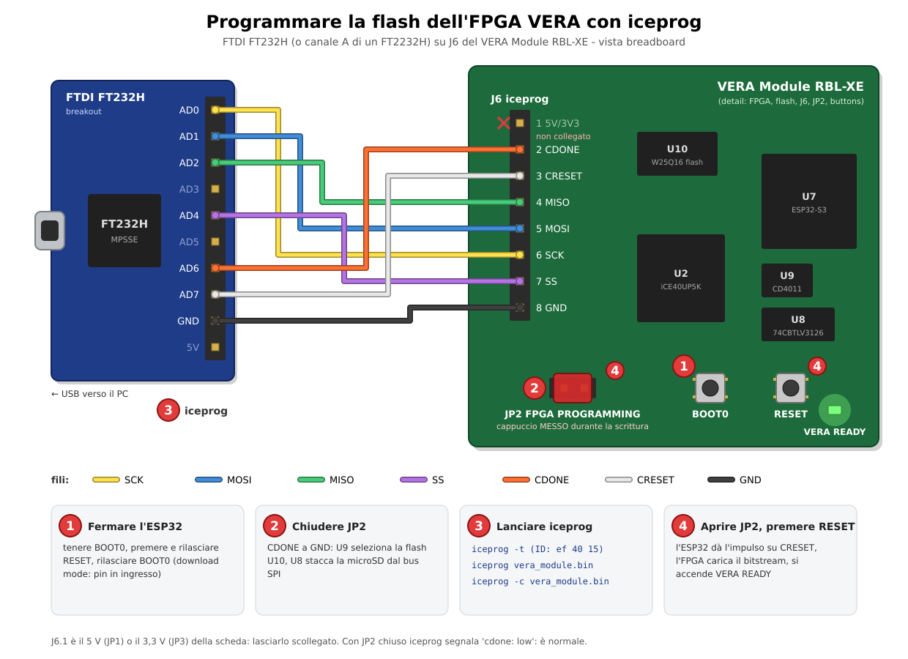
</div>

Il bitstream della VERA sta nella flash SPI U10 (W25Q16); l'FPGA lo carica all'accensione.
`iceprog` lo scrive tramite **J6** con un adattatore FTDI FT232H o FT2232H (MPSSE):

| Pin J6 | Segnale | FT232H / FT2232H (canale A) |
|---|---|---|
| 1 | 5 V (JP1) o 3,3 V (JP3), ponticello a saldare | non serve: lasciarlo scollegato |
| 2 | CDONE | ADBUS6 |
| 3 | CRESET | ADBUS7 |
| 4 | MISO (DO della flash) | ADBUS2 |
| 5 | MOSI (DI della flash) | ADBUS1 |
| 6 | SCK | ADBUS0 |
| 7 | SS (/CS della flash) | ADBUS4 |
| 8 | GND | GND |

1. Alimentare la scheda (nel computer) e **fermare l'ESP32**: tenere premuto BOOT0 (SW3),
   premere e rilasciare RESET (SW1), rilasciare BOOT0. In download mode i suoi pin sono ingressi;
   se gira, il firmware tiene CRESET (GPIO 38) alto contro iceprog.
2. **Chiudere JP2** ("FPGA PROGRAMMING"): CDONE va a GND, così U9 seleziona la flash e U8 stacca
   la microSD dal bus SPI.
3. Scrivere e verificare la flash:
   ```bash
   sudo apt install fpga-icestorm      # iceprog
   iceprog -t                          # legge l'ID della flash (W25Q16: ef 40 15)
   iceprog vera_module.bin             # cancella, scrive, verifica (il bitstream non è fornito)
   iceprog -c vera_module.bin          # solo verifica
   ```
   Con JP2 chiuso iceprog segnala `cdone: low`: è normale.
4. **Aprire JP2** e premere RESET (SW1): il firmware dell'ESP32 dà l'impulso su CRESET, l'FPGA
   carica il nuovo bitstream e CDONE va alto (si accende il LED "VERA READY").

#### Strumenti Sviluppo
- **IceStorm**: Toolchain FPGA open-source
- **Yosys**: Sintesi Verilog
- **NextPNR**: Place and route
- **KiCad**: Design e layout PCB

### Configurazione ESP32

#### Firmware ESP32
L'ESP32-S3FN8 (hot loop sul Core 0, log seriale sul Core 1) gestisce:
- **Sincronizzazione startup**: CRESET abbassato subito in `setup()` (prima di `Serial.begin`), poi rilasciato; si attende CDONE = HIGH (bitstream ICE40UP5K caricato, tipicamente < 100 ms, timeout 5 s) prima di avviare il loop del bus. L'Atari non si può tenere in reset: il 130XE pilota RST (ECI pin 2) direttamente con l'uscita del suo NE555, quindi la scheda lo legge soltanto (GPIO 48 via U6). Se all'accensione la scheda non è pronta quando l'OS cerca i dispositivi PBI, premere RESET
- **Decodifica Bus**: Decodifica software completa di A0–A15 campionati ad ogni fronte di salita di PHI2 — nessuna ambiguità di pagina, nessun hardware decoder esterno
- **Dedicated GPIO**: I segnali di controllo (EXTSEL\_N, DEV\_SEL\_N, MPD) vengono affermati in una singola istruzione Xtensa TIE (`ee.wr_mask_gpio_out`, 1 ciclo CPU) nella finestra PHI2-high di 279 ns
- **Bus Dati** *(solo modalità PBI)*: D0–D7 pilotati via `GPIO.out` per letture ROM ($D800–$DFFF) e RAM ($D600–$D7FF); in modalità CCTL è la FPGA a guidare il bus
- **Debug**: UART0 su GPIO43 (TX) / GPIO44 (RX), 115200 baud

La modalità operativa è scelta a **tempo di compilazione** tramite `VERA_BOARD_IS_PBI` in `main.cpp`:

| `VERA_BOARD_IS_PBI` | Modalità | Range attivi | Latch selezione |
|---------------------|----------|--------------|-----------------|
| `1` (default) | PBI  | $D100–$D1FF, $D600–$D7FF, $D800–$DFFF | write `0x80` su $D1FF |
| `0`           | CCTL | $D500–$D5FF                           | write `0x80` su $D5FF |

L'emulatore **RAMbo 256 KB** è sempre presente: nessun GPIO, ponticello o opzione di
compilazione lo accende o lo spegne. Il bit 4 di PORTB (`$D301`) a 0 apre la finestra da
256 KB a banchi a $4000–$7FFF; con il bit 4 a 1 risponde come sempre la RAM interna
dell'Atari. Il GPIO 3 non è usato dal firmware (ha solo il pull-up di strapping `R71`).

Funziona in entrambe le modalità PBI e CCTL. Il hot loop snoopa sia **PBCTL** (`$D303`)
sia **PORTB** (`$D301`): le write a `$D301` aggiornano il registro di selezione banco
**solo se** PBCTL bit 2 = 1 (Output Register selezionato). Quando bit 2 = 0, `$D301`
indirizza il DDR della PIA 6520 e la write viene ignorata. `PORTB` si inizializza a
`0xFF` (RAME = 1, RAMbo inattivo); `PBCTL` a `0x00` (bit 2 = 0, DDR esposto).

**Snooping passivo vs. pilotaggio attivo — nessun conflitto col 6520 fisico.** Il chip
6520 PIA rimane pienamente attivo sulla scheda madre dell'Atari e risponde a `$D301`/`$D303`
normalmente. L'ESP32 **non sostituisce** il 6520: osserva passivamente quei cicli bus senza
mai pilotare il bus dati per quegli indirizzi. Pilota attivamente D0–D7 e asserisce
EXTSEL\_N solo per la finestra `$4000–$7FFF`, dove il 6520 non è mappato. Il tracciamento
di PBCTL è necessario proprio perché lo snooping è passivo: dal bus, una write al DDR e una
write all'Output Register su `$D301` sono **indistinguibili** — lo stato di PBCTL è l'unico
modo per differenziarle.

#### Programmazione ESP32
Il firmware viene compilato con **PlatformIO** (installare con `pip install platformio`):
```bash
# Compila firmware (modificare VERA_BOARD_IS_PBI in main.cpp prima di compilare)
pio run -e esp32s3fn8

# Carica firmware — dalla porta USB-C (CH340C sulla scheda, UART0, GPIO 43/44)
pio run -e esp32s3fn8 --target upload
```

> **Nota**: USB CDC è disabilitato perché GPIO 19 (USB D−) e GPIO 20 (USB D+) sono
> riutilizzati come linee indirizzo A7 e A8. Il CH340C sulla scheda (USB-C) è collegato a UART0
> (GPIO 43/44) e porta l'ESP32 nel bootloader con DTR/RTS: non serve un adattatore esterno.

</div>

---

<div style="background: #ffffff; border-radius: 16px; padding: 24px; margin: 24px 0; box-shadow: 0 4px 12px rgba(0,0,0,0.1); border: 1px solid #e0e0e0;">

## 📁 Struttura Progetto

Il workflow di progetto, dallo schematico all'ordine JLCPCB (disponibilità dei componenti, aggiornamento della libreria, ERC, netlist, PCB e netclass, DRC, `output_job.sh`, file da consegnare), è descritto in [WORKFLOW.md](WORKFLOW.md) (anche in [PDF](WORKFLOW.pdf)).

### Organizzazione Repository

```
Vera-Module-RBL-XE/
├── 📄 README.md                    # Questa documentazione
├── 📄 WORKFLOW.md                  # Workflow di progetto, dallo schema all'ordine JLCPCB
├── 📄 LICENSE                      # Licenza GPL v3
├── ⚙️ VERA-MODULE-RBL.pro         # File progetto KiCad
├── 📄 VERA-MODULE-RBL.sch         # Schema principale
├── 🔧 VERA-MODULE-RBL.kicad_pcb   # Layout PCB
├── 📄 VERA-MODULE-RBL.csv         # Distinta materiali
├── 🐍 jlcpcb-check-bom.py        # Script elaborazione BOM
├── 📁 images/                      # Immagini scheda e render
│   ├── 🖼️ VERA-MODULE-RBL-TOP.png
│   ├── 🖼️ VERA-MODULE-RBL-BOTTOM.png
│   ├── 🖼️ F.Cu-L1.png            # Immagini layer PCB
│   ├── 🖼️ POWER-L2.png
│   ├── 🖼️ GND-L3.png
│   └── 🖼️ B.Cu-L4.png
├── 📁 production/                  # File produzione
│   ├── 📄 *.gbl, *.gtl            # File Gerber
│   ├── 📄 *.drl                   # File drill
│   └── 📄 *.gbrjob                # File job
├── 📁 ibom/                       # BOM interattiva
│   └── 🌐 ibom.html
└── 📁 schematics/                 # Schemi individuali
    ├── 📄 vera-fpga.sch           # Modulo FPGA
    ├── 📄 busdecoder.sch          # Decodificatore bus
    ├── 📄 cartridgeInterface.sch   # Interfaccia cartuccia
    ├── 📄 vera-fpga-flash.sch     # Memoria flash
    └── 📄 powersupply.sch         # Gestione alimentazione
```

### File Design

#### File KiCad
- **Schema**: Design gerarchico multi-foglio
- **Layout PCB**: Scheda 4-layer con impedenza controllata
- **Modelli 3D**: Modelli componenti personalizzati
- **Footprint**: Footprint connettori personalizzati

#### File Produzione
- **File Gerber**: Fabbricazione PCB standard industria
- **File Drill**: Specifiche drill NC e via
- **Pick & Place**: Coordinate assemblaggio SMT
- **BOM**: Specifiche componenti con codici LCSC

</div>

---

<div style="background: #ffffff; border-radius: 16px; padding: 24px; margin: 24px 0; box-shadow: 0 4px 12px rgba(0,0,0,0.1); border: 1px solid #e0e0e0;">

## 🤝 Contribuire

### Linee Guida Sviluppo

#### Processo Contribuzione
1. **Fork** del repository
2. **Creare** un branch feature
3. **Apportare** le modifiche
4. **Testare** accuratamente
5. **Inviare** una pull request

#### Aree Contribuzione
- **Design Hardware**: Miglioramenti layout PCB
- **Firmware**: Codice ESP32 e FPGA
- **Documentazione**: Guide utente e tutorial
- **Test**: Validazione e verifica
- **Software**: Applicazioni host e strumenti

#### Obiettivi Design
- **Compatibilità**: Mantenere compatibilità ATARI XE/XL
- **Performance**: Ottimizzare per velocità ed efficienza
- **Affidabilità**: Assicurare funzionamento robusto
- **Producibilità**: Design per produzione
- **Costo**: Bilanciare caratteristiche con convenienza

</div>

---

<div style="background: #ffffff; border-radius: 16px; padding: 24px; margin: 24px 0; box-shadow: 0 4px 12px rgba(0,0,0,0.1); border: 1px solid #e0e0e0;">

## 📄 Licenza

Questo progetto è licenziato sotto la **GNU General Public License v3.0**.

### Dettagli Licenza

#### Permessi
- ✅ Uso commerciale
- ✅ Modifica
- ✅ Distribuzione
- ✅ Uso brevetti
- ✅ Uso privato

#### Limitazioni
- ❌ Responsabilità
- ❌ Garanzia

#### Condizioni
- 📄 Avviso licenza e copyright
- 📄 Dichiarare modifiche
- 📄 Rivelare sorgente
- 📄 Stessa licenza

Per il testo completo della licenza, vedere il file [LICENSE](LICENSE).

</div>

---

<div style="background: linear-gradient(135deg, #1976d2, #42a5f5); color: white; border-radius: 16px; padding: 32px; margin: 32px 0; box-shadow: 0 8px 24px rgba(25,118,210,0.3); text-align: center;">

## 💙 Supporta il Progetto

Se trovi utile questo progetto, considera di:

🌟 **Mettere una stella** al repository  
🐛 **Segnalare** problemi  
🔧 **Contribuire** miglioramenti  
📢 **Condividere** con la community  

---

**Realizzato con ❤️ da RetroBit Lab**

*Portando capacità moderne ai computer classici*

</div>
